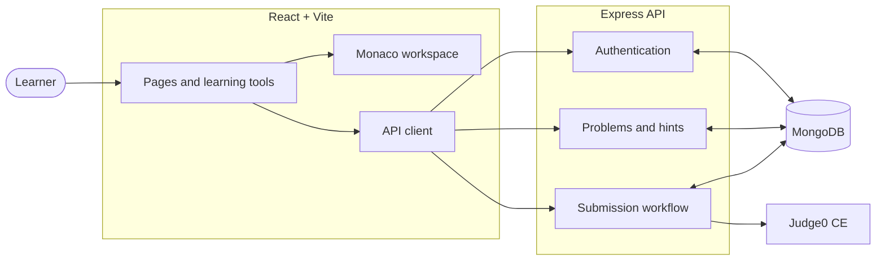
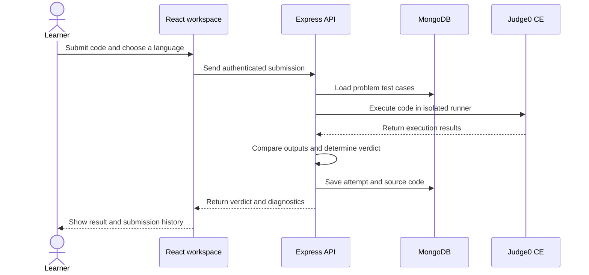

<div align="center">

# CodeMentor

### A calmer way to get better at code.

Practice data structures and algorithms in a focused workspace. Learn from each attempt, build steady habits, and track progress at your own pace.

[Demo](#-demo) · [Get started](#-get-started) · [Features](#-what-you-can-do) · [Architecture](#-how-it-fits-together) · [Commands](#-everyday-commands)


</div>

---

## ✨ What you can do

| Explore | Practice | Reflect |
| --- | --- | --- |
| Browse and filter a curated DSA library | Write Python 3, Java, or C++ in a Monaco-powered workspace | Review verdicts, diagnostics, and submitted source code |
| Follow guided learning paths | Run sample tests or bring your own input | Compare attempts and save private solution reflections |
| Save problems for later | Submit against hidden test cases using Judge0 | Track solved problems, accuracy, goals, and streaks |
| Reveal progressive hints and public edge cases | Practice debugging and step through algorithm visualizations | Review topic insights and your learning journal |

The interface includes a persistent light/dark theme, editor preferences, keyboard shortcuts, and focused practice sessions.

## 🎬 Demo

Watch the [CodeMentor demo video](https://www.loom.com/share/f0d4b2bf3afe425bbe3a45d24082814a) to see how the app works.

## 🧭 How it fits together



### What happens when code is submitted?



> **Execution safety:** submissions are sent to Judge0 CE, not run directly by the Express server. Hidden tests remain on the backend. The free public Judge0 service can be rate-limited or temporarily unavailable.

## 🛠️ Technology

- **Client:** React, Vite, React Router, Monaco Editor, and Lucide icons
- **API:** Node.js, Express, JWT authentication, and secure HTTP-only cookies
- **Data:** MongoDB with Mongoose
- **Code execution:** Free public Judge0 CE endpoint (no API key or RapidAPI host required by default)
- **Workspace:** npm workspaces for the client and server

## 🚀 Get started

### Prerequisites

- Node.js 20.19+ (or 22.12+) and npm
- MongoDB running locally, or a MongoDB connection string
- Internet access for Judge0 CE code execution

### 1. Install dependencies

Run this from the repository root:

```sh
npm install
```

### 2. Configure the API

Copy `server/.env.example` to `server/.env`, then set the values for your machine:

```env
PORT=5000
MONGODB_URI=mongodb://127.0.0.1:27017/codementor
JWT_SECRET=replace-this-with-a-long-random-secret-at-least-32-characters
CLIENT_ORIGIN=http://localhost:5173
```

Use a unique, private `JWT_SECRET` of at least 32 characters. Keep `.env` files private; the repository ignore rules exclude them. `JUDGE0_URL` is optional and only needed to override the default Judge0 CE endpoint.

### 3. Start MongoDB and seed the problem library

```sh
npm run seed
```

Seeding inserts or updates the built-in problems by slug, so it can also be used after pulling problem-data updates.

### 4. Start the app

```sh
npm run dev
```

This starts the Vite client and Express API together. Open the client URL printed in the terminal (normally [http://localhost:5173](http://localhost:5173)). The API health check is [http://localhost:5000/api/health](http://localhost:5000/api/health).

## 🚂 Deploying the backend to Render

Create a **Web Service** in Render and connect this repository. Because the backend is in an npm workspace, configure the service as follows:

- **Root Directory:** leave blank (repository root)
- **Build Command:** `npm install`
- **Start Command:** `npm run start -w server`

Add these environment variables in the Render service settings:

- `MONGODB_URI` — your MongoDB connection string
- `JWT_SECRET` — a private random secret of at least 32 characters
- `CLIENT_ORIGIN` — the exact origin of your deployed frontend, such as `https://your-vercel-domain.example`
- `NODE_ENV` — `production`

Render provides the `PORT` environment variable automatically. After deployment, check that `https://<your-render-service>.onrender.com/api/health` returns `{"status":"ok"}`. Use your Render service URL (ending in `/api`) for the frontend's `VITE_API_URL` setting below.

## ☁️ Deploying the client to Vercel

The root [`vercel.json`](./vercel.json) builds the Vite client from the monorepo and rewrites client-side routes to `index.html`. Import the repository into Vercel with the **repository root** as the project root; the configured build output is `client/dist`.

The Express API and MongoDB are separate services in this project. Deploy the API to Render using the instructions above and provision MongoDB, then configure these environment variables:

- **Vercel client:** `VITE_API_URL=https://your-api-host.example.com/api`
- **API host:** `MONGODB_URI`, `JWT_SECRET` (at least 32 characters), `CLIENT_ORIGIN=https://your-vercel-domain.example`, and `NODE_ENV=production`
- **API host, optional:** `JUDGE0_URL` to use a Judge0-compatible endpoint other than the public default

Set `VITE_API_URL` in Vercel's project environment-variable settings for each deployment environment, then redeploy. It must include the `/api` path. `CLIENT_ORIGIN` must exactly match the deployed client origin so credentialed authentication requests are allowed. The API's production auth cookie is cross-site, HTTP-only, and secure; deploy the client and API over HTTPS.

## 🧰 Everyday commands

Run commands from the repository root:

| Command | What it does |
| --- | --- |
| `npm run dev` | Start the client and API in development mode |
| `npm run build` | Create the production client build |
| `npm run lint` | Lint the client |
| `npm run seed` | Seed or update the problem library |
| `npm test -w server` | Run the server tests |
| `npm start -w server` | Start the API without watch mode |

To run a workspace command directly:

```sh
npm run dev -w client
npm run dev -w server
```

## 🔐 Environment reference

| Variable | Required | Description |
| --- | :---: | --- |
| `PORT` | No | API port; defaults to `5000` |
| `MONGODB_URI` | Yes | MongoDB connection string |
| `JWT_SECRET` | Yes | Private signing secret; use at least 32 characters |
| `CLIENT_ORIGIN` | No | Allowed browser origin; defaults to `http://localhost:5173` |
| `JUDGE0_URL` | No | Judge0-compatible endpoint override; defaults to `https://ce.judge0.com` |

For production, serve the client over HTTPS, set `NODE_ENV=production`, and configure `CLIENT_ORIGIN` to the exact deployed client origin. Never commit secrets or real environment files.

## 🗂️ Project map

```text
CodeMentor/
├── client/
│   ├── public/                 # Static assets
│   └── src/
│       ├── components/         # Shared interface components
│       ├── context/            # Authentication and theme state
│       ├── pages/              # Product pages and coding workspace
│       └── services/           # API client
├── server/
│   ├── config/                 # Database connection
│   ├── controllers/            # API handlers
│   ├── data/                   # Seed problems and learning content
│   ├── middleware/             # Authentication and error handling
│   ├── models/                 # Mongoose schemas
│   ├── routes/                 # API routes
│   ├── scripts/                # Database seed script
│   └── services/               # Judge0 integration and tests
├── package.json                # npm workspaces and root commands
└── README.md
```

## 🧪 Testing and privacy notes

- The backend test suite uses Node’s built-in test runner: `npm test -w server`.
- Problem detail responses omit hidden test cases; hints are fetched progressively.
- Per-problem submission history is scoped to the signed-in user. Source code is fetched only for an individual attempt.
- Reflections are private to the submitting user.
- Execution depends on the public Judge0 CE service and its availability and usage limits.

---

<div align="center">

**Progress, not perfection. One thoughtful attempt at a time.**

</div>
